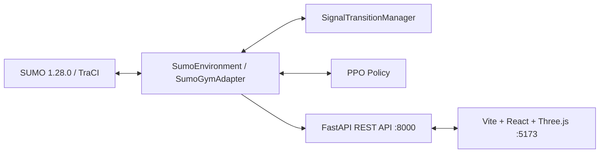

# Traffic-Opt-RL: Simulation-Based Safe Multi-Objective Adaptive Traffic Signal Optimization Using Reinforcement Learning

[](https://www.python.org/)
[](https://eclipse.dev/sumo/)
[]()
[](https://fastapi.tiangolo.com/)
[](https://react.dev/)
[](https://threejs.org/)

---

## 1. Executive Summary & Research Scope

**Traffic-Opt-RL** is a research framework for safe, adaptive traffic signal optimization in signalized urban intersections. The platform pairs a microscopic simulator (**Eclipse SUMO** with **TraCI**) with **Proximal Policy Optimization (PPO)** reinforcement learning, governed by a deterministic safety state machine (`SignalTransitionManager`).

### Core Research Contributions
1. **Unbypassable Safety Guardrails:** Implements a deterministic transition engine enforcing physical minimum green intervals ($5.0\text{ s}$), yellow change intervals ($3.0\text{ s}$), and maximum green limits ($45.0\text{ s}$). Reinforcement learning agents cannot command dangerous transitions or bypass clearance phases.
2. **Multi-Objective Reward Formulation:** Calibrated reward function combining time-averaged lane waiting time, queue dissipation, velocity drop/stopping events, and tailpipe emissions.
3. **Reproducible Held-Out Benchmarks:** Systematic tri-controller evaluation across three held-out demand scenarios (Seeds 301, 302, 303; 80, 97, 95 vehicles) comparing:
   - **Fixed-Time Baseline:** Deterministic cyclic schedule (42s green).
   - **Vehicle-Actuated Baseline:** Dynamic gap-out and queue-threshold controller.
   - **PPO Reinforcement Learning:** Trained neural policy (30,000 environment steps).
4. **Integrated 3D Telemetry Dashboard:** Glassmorphic web application combining procedural 3D intersection kinematics with authentic SUMO TraCI live execution, convergence tracking, and cross-scenario analytics.

---

## 2. System Architecture & Tech Stack



- **Simulation Engine:** Eclipse SUMO v1.28.0, TraCI API, Python 3.12
- **Reinforcement Learning:** Gymnasium, Stable-Baselines3 (PPO), PyTorch 2.5.1
- **Backend Service:** FastAPI, Pydantic, Uvicorn
- **Frontend Dashboard:** React 19, TypeScript 6, Vite 8, Lucide React
- **3D Visualization:** Three.js, React Three Fiber (`@react-three/fiber`), Drei (`@react-three/drei`)

---

## 3. Project Directory Structure

```
D:\Traffic-Opt-RL\
├── api\                        # FastAPI backend service
│   ├── main.py                 # REST routes (/api/status, /api/evaluations/*, /api/simulation/run)
│   └── __init__.py
├── config\                     # Validated configuration schema
│   ├── schema.py               # IntersectionConfig dataclass and validation rules
│   └── __init__.py
├── controllers\                # Traffic signal controllers
│   ├── base.py                 # BaseTrafficController interface
│   ├── fixed_time.py           # Fixed-time cyclic baseline
│   ├── actuated.py             # Vehicle-actuated gap-out baseline
│   ├── ppo.py                  # Trained PPO controller wrapper
│   └── __init__.py
├── data\                       # Route definitions and simulation fixtures
│   ├── routes\                 # Held-out demand scenarios (seeds 301, 302, 303)
│   └── routes_test\            # Unit test route fixtures
├── docs\                       # Research and technical documentation
│   ├── ARCHITECTURE.md         # Full system architecture specification
│   ├── MODULE_GUIDE.md         # File-by-file module reference
│   ├── EXPERIMENT_PROTOCOL.md  # Experimental benchmark methodology
│   ├── AUDIT_REPORT.md         # Verification audit log
│   └── TRAINING_GUIDE.md       # PPO training instructions
├── environment\                # Simulation environment and safety layer
│   ├── sumo_environment.py    # Core SUMO TraCI wrapper
│   ├── gym_wrapper.py         # Gymnasium adapter for RL
│   ├── transition_manager.py  # Deterministic safety state machine
│   ├── observation.py         # 26-dim observation builder
│   ├── reward.py              # Multi-objective reward engine
│   └── single_intersection.net.xml # 4-leg SUMO intersection network
├── evaluation\                 # Benchmark execution and metrics
│   ├── runner.py               # Experiment execution harness
│   ├── evaluate_all.py         # Batch tri-controller evaluation script
│   └── benchmark.py            # Baseline benchmark script
├── frontend\                   # 3D Glassmorphic React dashboard
│   ├── src\
│   │   ├── components\         # MetricCards, LiveSimulationPanel, ComparisonTable, etc.
│   │   ├── scene\              # Three.js Canvas, CameraRig, CityBlocks, Vehicles, etc.
│   │   ├── styles\             # dashboard.css design system
│   │   ├── App.tsx             # State orchestrator and tab router
│   │   └── types.ts            # Authoritative TypeScript types
│   ├── package.json
│   └── vite.config.ts
├── logs\                       # Training telemetry and convergence logs
│   └── ppo_production\         # progress.csv (234 rollout steps)
├── models\                     # Saved model checkpoints
│   └── ppo_production\         # ppo_traffic_final.zip & training_metadata.json
├── results\                    # Authentic held-out evaluation outputs
│   ├── eval_heldout_medium_301/ # Evaluation outputs for Scenario 1
│   ├── eval_heldout_medium_302/ # Evaluation outputs for Scenario 2
│   └── eval_heldout_medium_303/ # Evaluation outputs for Scenario 3
├── scripts\                    # Operational scripts
│   ├── generate_demand.py      # Reproducible traffic demand generator
│   └── run_server.py           # Standalone FastAPI server launcher
└── tests\                      # Comprehensive automated test suite (117 tests)
```

---

## 4. Prerequisites & Environment Setup

### 4.1 Prerequisites
- **Operating System:** Windows 10/11, Linux, or macOS
- **Python:** 3.12 (with `venv`)
- **SUMO:** Eclipse SUMO v1.28.0 (set `SUMO_HOME` environment variable)
- **Node.js:** v18+ with `npm`

### 4.2 Python Virtual Environment Setup
```powershell
# Navigate to project directory
cd D:\Traffic-Opt-RL

# Activate virtual environment
.venv\Scripts\Activate.ps1

# Verify SUMO installation
sumo --version
```

### 4.3 Frontend Setup
```powershell
cd D:\Traffic-Opt-RL\frontend
npm install
```

---

## 5. How to Run the Application

### 5.1 Start the FastAPI Backend
```powershell
# From D:\Traffic-Opt-RL with active .venv:
python -m uvicorn api.main:app --host 127.0.0.1 --port 8000 --reload
# Or using the helper script:
python scripts/run_server.py
```
The API is available at `http://127.0.0.1:8000`. Interactive OpenAPI documentation is accessible at `http://127.0.0.1:8000/docs`.

### 5.2 Start the Vite Frontend
```powershell
# In a separate terminal:
cd D:\Traffic-Opt-RL\frontend
npm run dev
```
Open your browser to `http://127.0.0.1:5173/` to view the 3D research dashboard.

---

## 6. How to Run Tests

### 6.1 Python Test Suite (117 Tests)
```powershell
# Run all unit tests
.venv\Scripts\python.exe -m unittest discover -s tests -p "test_*.py"
```

### 6.2 Frontend Build & Type Check
```powershell
cd D:\Traffic-Opt-RL\frontend
npm run build
npm run lint
```

---

## 7. How Training, Evaluation, and Live Simulation Differ

| Workflow | Entry Point | What It Does | Hardware Impact | Output Artifacts |
| :--- | :--- | :--- | :--- | :--- |
| **PPO Training** | `training/train_ppo.py` | Runs 30,000 steps of RL exploration, critic updates, and policy gradient optimization. | High (CPU/RAM) | `models/ppo_production/ppo_traffic_final.zip`, `logs/ppo_production/progress.csv` |
| **Held-Out Evaluation** | `evaluation/evaluate_all.py` | Evaluates FixedTime, Actuated, and PPO under identical seeds on held-out demand profiles. | Moderate | `results/eval_heldout_medium_*/evaluation_summary.json` |
| **Live Simulation Runner** | UI or `POST /api/simulation/run` | Executes an honest headless SUMO episode (e.g. 120 steps) on demand and streams step telemetry. | Low (< 2s) | Real-time JSON telemetry |
| **Procedural 3D Visualizer** | Frontend Viewport | Illustrative client-side car-following simulation rendered in Three.js at 60 FPS. | GPU only | Interactive canvas |

---

## 8. Research Metric Definitions

| Metric | Code Key | Unit | Formal Definition |
| :--- | :--- | :--- | :--- |
| **Lane Waiting Time** | `mean_waiting_time_seconds` | `s` | System-wide time-averaged lane waiting time across 8 incoming lanes: $\frac{\sum \text{accumulated waiting time}}{N_{\text{steps}}}$. Not single-vehicle trip delay. |
| **Approach Queue** | `mean_queue_vehicles` | `veh` | Mean count of halted vehicles (speed $< 0.1\text{ m/s}$) queued across approaches. |
| **Vehicle Stops** | `total_stops` | `stops` | Number of distinct vehicle deceleration events to $0\text{ m/s}$. |
| **CO₂ Emissions** | `total_emissions_mg` | `kg` | Cumulative tailpipe emissions calculated using the HBEFA3 emission model ($1\text{ kg} = 10^6\text{ mg}$). |
| **Throughput** | `total_throughput_vehicles` | `veh` | Total vehicles that traversed the stop bar and exited the intersection during the episode. |
| **Reward** | `total_reward` | `pts` | Dimensionless composite objective score evaluated by `RewardCalculator`. |

---

## 9. Experimental Results (Held-Out Evaluation)

Summary of results on Held-Out Demand Scenario 1 (Seed 301, 80 vehicles, 300s):

| Metric | Fixed-Time Baseline | Actuated Controller | PPO Controller (30k Steps) | PPO vs. Fixed-Time |
| :--- | :---: | :---: | :---: | :---: |
| **Lane Waiting Time** | $37.80 \pm 3.88\text{ s}$ | $0.73 \pm 0.07\text{ s}$ | $\mathbf{0.68 \pm 0.06\text{ s}}$ | **-98.2%** |
| **Approach Queue** | $2.42 \pm 0.20\text{ veh}$ | $0.33 \pm 0.02\text{ veh}$ | $\mathbf{0.30 \pm 0.03\text{ veh}}$ | **-87.5%** |
| **Total Stops** | $53.33 \pm 4.51$ | $43.33 \pm 4.04$ | $\mathbf{42.00 \pm 4.36}$ | **-21.2%** |
| **CO₂ Emissions** | $4.38 \pm 0.13\text{ kg}$ | $\mathbf{2.62 \pm 0.03\text{ kg}}$ | $2.64 \pm 0.01\text{ kg}$ | **-39.7%** |
| **Cumulative Reward** | $-179.50 \pm 17.72$ | $-4.54 \pm 0.45$ | $\mathbf{-4.31 \pm 0.51}$ | **+97.6%** |
| **Completed Throughput** | $80.0 \pm 0.0\text{ veh}$ | $80.0 \pm 0.0\text{ veh}$ | $80.0 \pm 0.0\text{ veh}$ | $100\%$ completed |

---

## 10. Safety Constraints & Transition Rules

The intersection operates under strict physical timing guardrails enforced by `SignalTransitionManager`:
- **Minimum Green Interval ($5.0\text{ s}$):** Guarantees safe pedestrian crossing start and driver expectation compliance.
- **Yellow Clearance Interval ($3.0\text{ s}$):** Eliminates dilemma zones and guarantees intersection clearance before cross-traffic is served.
- **Maximum Green Interval ($45.0\text{ s}$):** Precludes starvation on competing approaches.
- **Control Interval ($1.0\text{ s}$):** Discrete decision frequency for the RL agent.

---

## 11. Troubleshooting & FAQs

### Q1: `ModuleNotFoundError: No module named 'gymnasium'`
Ensure you are using the dedicated virtual environment Python binary:
```powershell
.venv\Scripts\python.exe -m unittest discover -s tests -p "test_*.py"
```

### Q2: `TraCI server closed connection unexpectedly`
Check that no orphaned SUMO process is occupying the TraCI port:
```powershell
Stop-Process -Name "sumo" -ErrorAction SilentlyContinue
```

### Q3: 3D Scene Performance on Integrated Intel GPUs
Open the **Settings** view in the dashboard (gear icon in the top right) and select **Balanced** or **Low** rendering quality. This disables high-resolution shadow maps and caps DPR to 1.0, ensuring smooth 60 FPS performance.

---

## 12. Known Limitations & Future Work

1. **Single Intersection Scope:** The current implementation models an isolated 4-leg intersection. Multi-intersection arterial coordination is planned for future work.
2. **Pedestrian Phase Integration:** Pedestrians are currently modeled via physical crosswalk timing allocations; actuated pedestrian push-button logic is a target for extension.
3. **Hardware Acceleration:** PPO inference is optimized for CPU execution; batch GPU inference can be enabled for large-scale multi-junction networks.
