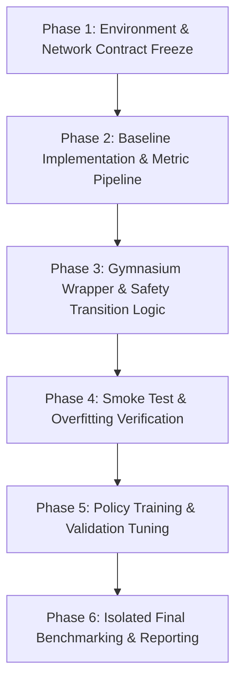

# Research Plan: Simulation-Based Safe Multi-Objective Adaptive Traffic Signal Optimization Using Reinforcement Learning

- **Project:** Simulation-Based Safe Multi-Objective Adaptive Traffic Signal Optimization Using Reinforcement Learning
- **Repository:** `D:\Traffic-Opt-RL`
- **Document Version:** 1.0 (Provisional Architecture & Specification)
- **Status:** Approved for Phase 1 Coordination; awaiting network definition and baseline alignment with Simulation Engineer.

---

## 1. Research Objective & Questions

### 1.1 Objective
Develop, benchmark, and evaluate an adaptive reinforcement learning (RL) traffic-signal controller for an isolated four-way signalized intersection in Eclipse SUMO. The controller aims to balance traffic throughput and delay reduction with environmental impact (emissions/fuel consumption) while ensuring that explicit signal-phase and timing constraints (minimum green durations, legal phase transitions, and clearance intervals) are deterministically enforced and verified within the simulation.

### 1.2 Core Research Questions
1. **Performance vs. Baselines:** Under identical demand scenarios and random seeds, does an RL-based adaptive controller significantly reduce average vehicle waiting time, queue lengths, and stop frequency compared to tuned fixed-time and sensor-actuated baselines?
2. **Multi-Objective Trade-Off:** How does optimizing for waiting time affect fuel consumption and emissions (CO2, CO, NOx, PMx)? Can multi-objective reward formulation yield joint improvements without sacrificing vehicular throughput?
3. **Generalization across Demand Regimes:** How robust is the learned policy when evaluated across low, medium, and high demand profiles, as well as unobserved, time-varying traffic surges?
4. **Safety Enforcement:** How can explicit signal-timing constraints (minimum green durations, legal phase progressions, and required clearance intervals) be decoupled from the policy and guaranteed by the deterministic controller/environment wrapper?

---

## 2. Scope, Assumptions, and Hardware Constraints

### 2.1 Scope
- **Intersection Topology:** A single, isolated four-way junction (four incoming approaches: North, South, East, West) with dedicated lanes for through and turning movements as defined by the simulation engineer.
- **Traffic Modes:** Passenger light-duty vehicles only in the initial scope; pedestrians and emergency preemption deferred to future extensions.
- **RL Algorithm Candidate:** Proximal Policy Optimization (PPO) serves as an initial candidate algorithm for evaluation due to its common use in discrete control tasks. It is not assumed to be the optimal or proven best algorithm for this setup (alternative methods such as DQN or rule-based adaptations remain open for comparison). Training will not begin until the environment contract is frozen.
- **No Novelty or Performance Fabrications:** No performance improvements, optimal reward weights, or research novelties are claimed upfront. All conclusions must stem from verified, reproducible simulation logs.

### 2.2 Assumptions
1. SUMO simulation steps represent discrete physical time increments (e.g., step size $\Delta t_{\text{sim}} = 1.0\,\text{s}$).
2. State estimation assumes reliable lane-level sensor data (e.g., induction loops or TraCI lane-area detectors) without sensor failure or communication packet drop in the primary benchmark.
3. Network geometry, lane lengths, and signal heads are fixed throughout each simulation run.

### 2.3 Hardware & Tooling Constraints
- **Platform:** Windows 11, local execution on 16 GB RAM with integrated graphics.
- **Software Stack:** Open-source only — Python 3.12 (`.venv`), Eclipse SUMO 1.28.0 (TraCI and sumolib), NumPy, and standard RL tooling (e.g., Gymnasium / Stable-Baselines3 when introduced).
- **Compute Budget:** Local CPU-friendly training runs. Simulation step horizons, episode lengths, and parallel rollout limits must remain computationally tractable without requiring paid APIs or external cloud infrastructure.

---

## 3. Engineering Roles & Responsibilities

| Responsibility Area | AI/RL Engineer | Simulation Engineer (Varnika) |
| :--- | :--- | :--- |
| **Network & Geometry** | Reviews sensor placement requirements and state feasibility. | Designs, validates, and maintains `*.net.xml` for the 4-way intersection in SUMO. |
| **Traffic Demand** | Defines train/val/test splits and random seed isolation policy. | Generates realistic low, medium, and high demand routes (`*.rou.xml`, `*.trips.xml`). |
| **Conventional Baselines** | Interfaces baselines into unified evaluation harness. | Formulates and tunes fixed-time signal programs and rule-based actuated controllers. |
| **Environment Wrapper** | Implements Gymnasium-compliant environment, state transforms, and reward calculation. | Validates TraCI API bindings, lane subscription keys, and simulation stability. |
| **Safety Transition Layer** | Implements the deterministic state machine enforcing signal transitions and timing bounds. | Verifies legal phase definitions, yellow times, and all-red intervals against traffic engineering rules. |
| **RL Agent & Training** | Designs policy architecture, training loops, evaluation runs, and statistical tests. | Assesses simulation output validity (e.g., gridlocks, unrealistic queuing artifacts). |
| **Metric Extraction** | Compiles metric summaries, distributions, and comparative plots. | Validates SUMO-native emission outputs (`emission-output`, `tripinfo-output`, `summary`). |

---

## 4. Safety Architecture: Hard Constraints vs. Soft Objectives

A foundational principle of this project is that **safety is never entrusted to a neural network reward function**. A reward penalty cannot mathematically guarantee zero violations during exploration or out-of-distribution evaluation. Furthermore, all safety claims in this project are strictly limited to the explicit signal-phase and timing constraints (such as minimum green times, legal phase combinations, and clearance intervals) deterministically enforced and verified within the SUMO simulation.

```
       +---------------------------------------------+
       |             RL Agent (Policy)               |
       +---------------------------------------------+
                              |
                     Candidate Action
                              v
       +---------------------------------------------+
       |   Deterministic Signal Transition Manager   |
       |             (Hard Safety Layer)             |
       |  - Follows validated SUMO tlLogic program   |
       |  - Enforces minimum green duration          |
       |  - Enforces maximum green duration          |
       |  - Enforces legal phase transition graph    |
       |  - Prevents duplicating existing clearances |
       +---------------------------------------------+
                              |
                    Sanitized Traffic Phase
                              v
       +---------------------------------------------+
       |             SUMO / TraCI Engine             |
       +---------------------------------------------+
```

### 4.1 Hard Safety Constraints & tlLogic Alignment
The environment layer wraps TraCI and acts as a strict guardrail, operating under the following requirements:
1. **Adherence to Validated `tlLogic`:** The `SignalTransitionManager` must directly follow the validated traffic light program (`tlLogic`) defined in the SUMO network. It must not duplicate yellow or all-red phases if those clearance states are already explicitly defined as intermediate phases in the network's traffic-light program, preventing unwanted clearance doubling or artificial timing drift.
2. **Minimum Green Time ($t_{\text{min\_green}}$):** Once a green phase is initiated, it cannot be preempted or switched until it has been active for at least $t_{\text{min\_green}}$ seconds (e.g., provisional 10–15s, subject to network validation).
3. **Clearance Intervals ($t_{\text{yellow}}$ and $t_{\text{all\_red}}$):** Whenever transitioning between conflicting green phases, the transition manager ensures that appropriate yellow change intervals (e.g., 3–4s) and all-red clearance intervals (e.g., 1–2s) are served as dictated by the validated signal program before giving green to conflicting traffic movements.
4. **Legal Phase Transitions:** The agent may only select or trigger transitions to valid, non-conflicting green phases defined in the network's signal logic. Conflicting movements are physically prevented from having simultaneous green indications.
5. **Maximum Green Time ($t_{\text{max\_green}}$):** A provisional upper bound (e.g., 60s) to prevent starvation on opposing approaches should the agent attempt to hold a single phase indefinitely.

### 4.2 Soft Optimization Objectives (Reward Layer)
The agent's objective is to optimize flow efficiency and environmental impact within the safety envelope. Soft objectives are communicated purely via scalar reward signals:
- Minimizing accumulated vehicle delay and waiting time.
- Minimizing queue length on incoming approaches.
- Minimizing stop-and-go events (acceleration variance).
- Minimizing fuel consumption and tailpipe emissions.

---

## 5. State / Observation Interface (Provisional)

*Note: All fields below are provisional and subject to verification once Varnika finalizes the intersection geometry and TraCI detector configuration.*

At control step $k$, the observation vector $\mathbf{s}_k$ is constructed from incoming approaches. For an intersection with $L$ incoming lanes:

| Feature Name | Dimension | Description | Normalization / Bounds |
| :--- | :--- | :--- | :--- |
| `lane_queue_lengths` | $\mathbb{R}^L$ | Number of halted vehicles (speed $< 0.1\,\text{m/s}$) on each incoming lane. | $[0, 1]$ scaled by max lane capacity $N_{\text{max}}$ |
| `lane_vehicle_counts` | $\mathbb{R}^L$ | Total vehicles occupying each incoming lane. | $[0, 1]$ scaled by max lane capacity $N_{\text{max}}$ |
| `lane_waiting_times` | $\mathbb{R}^L$ | Provisional candidate metric: total accumulated waiting time (seconds spent with vehicle speed $< 0.1\,\text{m/s}$) summed across all vehicles currently halted on lane $l$, scaled by $(N_{\text{max}} \times T_{\text{wait\_ref}})$ where $T_{\text{wait\_ref}}$ is a nominal threshold (e.g., 60s). This definition is provisional pending confirmation of available TraCI data feeds (e.g., `traci.lane.getWaitingTime` vs. induction loop detectors). | $[0, 1]$ |
| `lane_average_speeds` | $\mathbb{R}^L$ | Mean speed of vehicles on each approach lane. | $[0, 1]$ scaled by lane speed limit $v_{\text{max}}$ |
| `current_phase_one_hot` | $\{0, 1\}^P$ | One-hot indicator of the currently active green phase ($P$ distinct green phases). | Discrete binary |
| `elapsed_phase_time` | $\mathbb{R}^1$ | Duration the current green phase has been active. | $[0, 1]$ scaled by $t_{\text{max\_green}}$ |
| `min_green_satisfied` | $\{0, 1\}^1$ | Binary flag indicating if current phase has met $t_{\text{min\_green}}$. | $\{0, 1\}$ |

**Total Observation Space:** Continuous vector $\mathbb{R}^{4L + P + 2}$ (provisional).

---

## 6. Action Interface Candidates (Provisional)

The action space defines how the agent controls the traffic light. We consider two candidate architectures to be evaluated with the simulation engineer:

### Candidate A: Discrete Phase Selection
- **Action Space:** Discrete action $a_k \in \{0, 1, \dots, P-1\}$, where each action corresponds to a specific green phase index.
- **Execution Logic:**
  - If $a_k == \text{current\_phase}$: The current green phase continues for another control interval $\Delta t_{\text{ctrl}}$.
  - If $a_k \neq \text{current\_phase}$:
    - If elapsed green $< t_{\text{min\_green}}$, the transition request is deferred/rejected; the current green phase continues.
    - If elapsed green $\ge t_{\text{min\_green}}$, the environment initiates the transition following the validated SUMO `tlLogic` program (stepping through native yellow and all-red clearance states without duplicating them) before reaching green phase $a_k$.
- **Trade-Off:** Provides the agent freedom to skip unneeded phases under asymmetric traffic, but requires careful transition handling and variable control step durations if clearance phases are handled internally.

### Candidate B: Green-Time Extension (Binary Keep / Switch)
- **Action Space:** Discrete action $a_k \in \{0, 1\}$.
  - $a_k = 0$: Extend current phase by fixed duration $\Delta t_{\text{ext}}$ (e.g., 5s).
  - $a_k = 1$: Switch to next phase in cyclic sequence (progressing through yellow and all-red clearance phases defined in `tlLogic` without duplicating them).
- **Execution Logic:** Strict cyclic order of phases ($0 \rightarrow 1 \rightarrow \dots \rightarrow P-1 \rightarrow 0$).
- **Trade-Off:** Simpler transition management and guaranteed cyclic fairness, but loses the ability to dynamically prioritize heavily congested directions over empty ones.

**Alignment Task:** Coordinate with Varnika to determine which candidate aligns best with the SUMO traffic light program (`tlLogic`) defined in the network.

---

## 7. Multi-Objective Reward Design Principles (Provisional)

Reward formulation must avoid arbitrary, unvalidated coefficient hacking before baseline metrics are collected. The reward $r_k$ at step $k$ is formulated over explicitly normalized, dimensionless component terms $\hat{\mathcal{C}}$ and $\hat{\mathcal{B}}$:

$$r_k = - \left( w_1 \cdot \hat{\mathcal{C}}_{\text{delay}} + w_2 \cdot \hat{\mathcal{C}}_{\text{queue}} + w_3 \cdot \hat{\mathcal{C}}_{\text{stops}} + w_4 \cdot \hat{\mathcal{C}}_{\text{emissions}} \right) + w_5 \cdot \hat{\mathcal{B}}_{\text{throughput}}$$

where $w_1, \dots, w_5 \ge 0$ are provisional non-negative weighting factors.

### 7.1 Component Definitions & Normalization Method
To prevent individual terms with disparate physical units (seconds, vehicle counts, milligrams) from dominating the gradient purely due to numerical scale, each term must be normalized by an explicit reference scale before weighting:

1. **Normalized Delay Cost ($\hat{\mathcal{C}}_{\text{delay}}$):**
   $$\hat{\mathcal{C}}_{\text{delay}} = \frac{\mathcal{C}_{\text{delay}}}{D_{\text{ref}}}$$
   where $\mathcal{C}_{\text{delay}}$ is the sum of vehicle waiting times across all incoming lanes during interval $\Delta t$, and $D_{\text{ref}} = L \cdot N_{\text{max}} \cdot \Delta t$ represents a theoretical maximum waiting accumulation over the interval.
2. **Normalized Queue Cost ($\hat{\mathcal{C}}_{\text{queue}}$):**
   $$\hat{\mathcal{C}}_{\text{queue}} = \frac{\mathcal{C}_{\text{queue}}}{Q_{\text{ref}}}$$
   where $\mathcal{C}_{\text{queue}}$ is the count of halted vehicles across incoming lanes, and $Q_{\text{ref}} = L \cdot N_{\text{max}}$ is the total physical storage capacity of all incoming lanes.
3. **Normalized Stop Cost ($\hat{\mathcal{C}}_{\text{stops}}$):**
   $$\hat{\mathcal{C}}_{\text{stops}} = \frac{\mathcal{C}_{\text{stops}}}{S_{\text{ref}}}$$
   where $\mathcal{C}_{\text{stops}}$ is the count of vehicles forced to decelerate to a halt during $\Delta t$, and $S_{\text{ref}}$ is the nominal maximum vehicle arrivals in $\Delta t$.
4. **Normalized Emission Cost ($\hat{\mathcal{C}}_{\text{emissions}}$):**
   $$\hat{\mathcal{C}}_{\text{emissions}} = \frac{\mathcal{C}_{\text{emissions}}}{E_{\text{ref}}}$$
   where $\mathcal{C}_{\text{emissions}}$ is total tailpipe emissions (CO2-equivalent mg/s), and $E_{\text{ref}}$ is an empirical reference emission scale determined from fixed-time baseline runs under medium demand.
5. **Normalized Throughput Bonus ($\hat{\mathcal{B}}_{\text{throughput}}$):**
   $$\hat{\mathcal{B}}_{\text{throughput}} = \frac{\mathcal{B}_{\text{throughput}}}{B_{\text{ref}}}$$
   where $\mathcal{B}_{\text{throughput}}$ is the count of vehicles successfully clearing the intersection during $\Delta t$, and $B_{\text{ref}}$ is the theoretical maximum intersection capacity over $\Delta t$.

### 7.2 Provisional Weighting Status & Validation Rules
- **All Weights are Strictly Provisional:** Arbitrary initial weights (e.g., exploratory starting values such as $w_1 = 1.0, w_2 = 0.5, w_3 = 0, w_4 = 0, w_5 = 0$) are not calibrated, optimized, or normalized weights. They serve solely as initial placeholders to verify policy gradient flow on delay reduction before multi-objective tuning.
- **Empirical Tuning Protocol:** Final weight configurations remain strictly provisional until baseline data (fixed-time and actuated) is established on validation scenarios, allowing systematic sensitivity sweeps.
- **Metric Isolation:** Each raw physical metric (seconds of waiting time, meters of queue, grams of emissions, total vehicle throughput) must be recorded and logged independently in TensorBoard and CSV files. Optimization success will never be evaluated by cumulative reward values alone, but by unweighted physical engineering metrics.

---

## 8. Traffic Scenarios & Train / Validation / Test Protocol

To ensure research rigor, data snooping and seed overfitting must be strictly prevented.

```
+---------------------------------------------------------------------------------+
|                                 Scenario Sets                                   |
+---------------------------------------------------------------------------------+
| 1. Training Set      | 3 Demand Levels (Low, Med, High) | Seeds: [101 - 105]    |
|                      | Used for policy gradient updates and exploration.       |
+----------------------+----------------------------------------------------------+
| 2. Validation Set    | 3 Demand Levels                  | Seeds: [201 - 203]    |
|                      | Used for checkpoint selection and hyperparameter tuning. |
+----------------------+----------------------------------------------------------+
| 3. Final Test Set    | 3 Demand Levels + 1 Surge Case   | Seeds: [301 - 310]    |
| (Strictly Isolated)  | Completely isolated until final comparative reporting.   |
+---------------------------------------------------------------------------------+
```

### 8.1 Demand Profiles (Provisional Estimates)
*Note: The following demand ranges are provisional planning estimates. Exact flow rates and arrival distributions will be calibrated and finalized once Varnika validates the intersection geometry, lane counts, saturation flow rates, and demand-generation scripts.*

- **Low Demand (Provisional):** ~200–400 vehicles/hour/approach. Free-flow conditions, tests phase-skipping efficiency.
- **Medium Demand (Provisional):** ~600–900 vehicles/hour/approach. Balanced congestion, typical peak-shoulder flow.
- **High Demand (Provisional):** ~1100–1400 vehicles/hour/approach. Near-saturation, tests spillback mitigation and queue balance.
- **Dynamic Surge (Provisional, Unseen Test Only):** Demand dynamically transitioning from low to high and back to low to test adaptation under non-stationary distributions.

### 8.2 Seed Management Rules
- Training and evaluation seeds must never overlap.
- Final test seeds are strictly quarantined: they cannot be used to tune hyperparameters, adjust reward coefficients, or select model checkpoints.
- All evaluation runs report mean and standard deviation across at least 5 distinct test seeds.

---

## 9. Baseline Controllers & Benchmark Metrics

### 9.1 Baseline Controllers
1. **Fixed-Time Controller:**
   - Pre-timed cyclic schedule with fixed green phase durations based on Webster's formula or standard split allocation for the expected demand.
   - Implemented as a standalone TraCI controller loop or native SUMO fixed traffic light program.
2. **Sensor-Actuated Controller:**
   - Standard gap-out / extension rule: green phase is extended if vehicle passage is detected within gap threshold $t_{\text{gap}}$, up to $t_{\text{max\_green}}$, otherwise switches.
   - Represents industrial standard adaptive traffic control.

### 9.2 Evaluation Metrics
All controllers (Fixed-time, Actuated, RL) are evaluated on the exact same seed-matched simulation runs using:

| Category | Metric | SUMO Source | Unit |
| :--- | :--- | :--- | :--- |
| **Mobility & Delay** | Average Waiting Time | `tripinfo-output` (`waitingTime`) | seconds/vehicle |
| | Mean Travel Time | `tripinfo-output` (`duration`) | seconds |
| | Mean Time Loss | `tripinfo-output` (`timeLoss`) | seconds |
| **Congestion** | Mean & Max Queue Length | TraCI / `lane-area-detector` | vehicles or meters |
| | Average Number of Stops | `tripinfo-output` (`waitingCount`) | stops/vehicle |
| **Efficiency** | Throughput | Count of vehicles completed | vehicles/hour |
| **Environmental** | Total CO2 Emissions | `emission-output` / TraCI | kg or grams |
| | Total Fuel Consumption | `emission-output` / TraCI | liters or ml |

---

## 10. Staged Implementation & Validation Plan



### Milestone 1: Environment & Network Contract Freeze (Current Milestone)
- Formalize intersection specification with Varnika (number of lanes, phase strings, detector IDs).
- Verify SUMO configuration file (`*.sumocfg`) and routes.
- **Deliverable:** Working network and route files validated via TraCI inspection script.

### Milestone 2: Baseline Implementation & Metric Pipeline
- Simulation engineer provides fixed-time and actuated controller implementations.
- Establish automated metric extraction script parsing `tripinfo.xml` and `emission.xml`.
- **Deliverable:** Baseline performance benchmarks on Validation scenarios.

### Milestone 3: Gymnasium Environment & Safety Filter
- Build `TrafficSignalEnv` conforming to standard Gymnasium API.
- Implement the deterministic `SignalTransitionManager` with enforced $t_{\text{min\_green}}$, $t_{\text{yellow}}$, and $t_{\text{all\_red}}$.
- **Deliverable:** Unit tests proving zero clearance/transition violations across random action streams.

### Milestone 4: Single-Scenario Overfit Test
- Verify RL pipeline end-to-end using candidate PPO on a single fixed-seed scenario to sanity-check policy gradient flow and implementation correctness.
- Confirm agent can learn to outperform random action selection and reduce queues on a static traffic stream.
- **Deliverable:** Overfitting learning curve verifying pipeline correctness.

### Milestone 5: Multi-Demand Training & Validation
- Train across low, medium, and high training seeds.
- Track metrics on the validation set; tune hyperparameters without touching the final test set.
- **Deliverable:** Frozen policy checkpoint.

### Milestone 6: Final Isolated Testing & Analysis
- Execute final evaluation across isolated test seeds and dynamic surge scenario.
- Perform statistical hypothesis testing (paired t-tests or Wilcoxon signed-rank tests) comparing RL vs. Fixed-time and Actuated controllers.
- **Deliverable:** Final results report and figures with complete experimental reproducibility.

---

## 11. Known Limitations & Threats to Validity

1. **Simulation-to-Reality Gap:** SUMO uses car-following models (Krauss) and lane-changing models (LC2013) that approximate real human driving behavior; real-world compliance, sensor noise, and communication delays are idealized.
2. **Isolated Intersection Scope:** Traffic signal coordination across arterial networks is not modeled in this initial single-intersection scope.
3. **Fuel/Emission Model Dependence:** SUMO emission calculations (HBEFA3-based) depend on vehicle speed and acceleration traces; results are relative indicators of environmental impact rather than absolute physical measurements.
4. **Stationary Fleet Composition:** Default vehicle type distributions assume uniform vehicle dynamics; heavy commercial vehicles or varied driver assertiveness are deferred.
