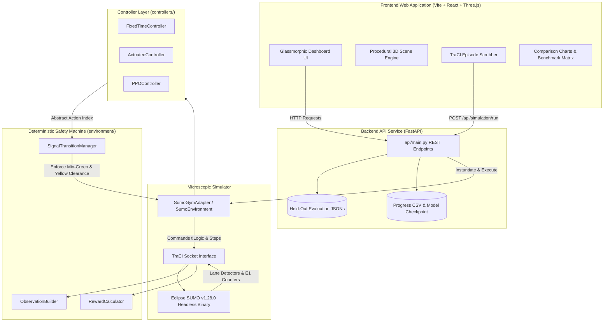
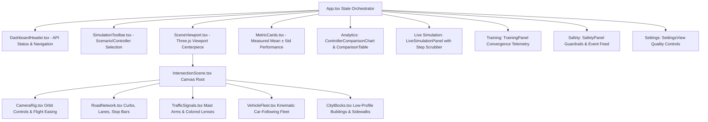

# Traffic-Opt-RL: System Architecture & Integration Specification

**Project Title:** Simulation-Based Safe Multi-Objective Adaptive Traffic Signal Optimization Using Reinforcement Learning
**Working Directory:** `D:\Traffic-Opt-RL`
**Stack:** Python 3.12, Eclipse SUMO 1.28.0, TraCI, Stable-Baselines3 (PPO), FastAPI, React 19, Vite 8, TypeScript 6, Three.js, React Three Fiber

---

## 1. System Overview

Traffic-Opt-RL is an end-to-end research platform for developing, validating, and visualizing safe reinforcement learning (RL) policies for traffic signal control. It integrates:
1. **Microscopic Traffic Simulator:** Eclipse SUMO with TraCI API driving realistic vehicle car-following and lane-changing physics.
2. **Deterministic Safety State Machine:** `SignalTransitionManager` guaranteeing that physical minimum green, yellow clearance, and maximum green constraints cannot be violated by any controller or exploratory RL action.
3. **Reinforcement Learning Pipeline:** Stable-Baselines3 Proximal Policy Optimization (PPO) trained over 30,000 steps with multi-objective reward balancing queue dissipation, delay minimization, vehicle stops, and emission reduction.
4. **FastAPI Telemetry Backend:** Asynchronous REST API serving model checkpoints, training convergence curves, held-out evaluation datasets, and executing on-demand SUMO episodes.
5. **3D Glassmorphic Research Dashboard:** Modern React + Three.js application featuring procedural 3D intersection kinematics, camera controls, live analytics, and a TraCI simulation execution runner.

---

## 2. High-Level Subsystem Architecture

---

## 3. Subsystem Breakdown & Contracts

### 3.1 Configuration Contract (`config/schema.py`)
Decouples network topology from controller policies through `IntersectionConfig`:
- **`tls_id`**: Network junction identifier (`"C"`).
- **`incoming_lanes`**: List of incoming approach lanes (`N_in_0`, `N_in_1`, `S_in_0`, `S_in_1`, `E_in_0`, `E_in_1`, `W_in_0`, `W_in_1`).
- **`green_phase_indices`**: Valid green phase indices in SUMO `tlLogic` (`[0, 2]`: Phase 0 = North-South Green; Phase 2 = East-West Green).
- **`min_green_seconds`**: 5.0 seconds.
- **`yellow_seconds`**: 3.0 seconds.
- **`max_green_seconds`**: 45.0 seconds.
- **`control_interval_seconds`**: 1.0 second per decision point.

### 3.2 Signal Safety State Machine (`environment/transition_manager.py`)
Acts as an unbypassable guardrail between controllers and SUMO:
1. **Minimum Green Enforcement:** Once green phase $P$ commences, any transition request to conflicting phase $Q$ is rejected until elapsed green time $\ge 5.0\text{ s}$.
2. **Deterministic Yellow Clearance:** When a valid transition $P \to Q$ is accepted, the environment commands yellow clearance for exactly $3.0\text{ s}$. Observations and controller decisions are inhibited during clearance.
3. **Maximum Green Bound:** If a phase reaches $45.0\text{ s}$, the manager signals that green duration has expired, preventing vehicle starvation on competing approaches.
4. **State Isolation:** Rejected action requests do not modify internal timers or phase tracking.

### 3.3 Observation Space Specification (`environment/observation.py`)
At every valid decision point (green phases only), the environment constructs a standardized 26-dimensional float32 observation vector:
- **Indices 0–7 (Queues):** Halted vehicle count per incoming lane (normalized by 20.0).
- **Indices 8–15 (Counts):** Total vehicles detected on approach per incoming lane (normalized by 25.0).
- **Indices 16–23 (Waiting Times):** Accumulated waiting time per incoming lane (normalized by 100.0s).
- **Indices 24–31 (Speeds):** Mean approach speed per incoming lane (normalized by speed limit 13.89 m/s).
- **Indices 32–33 (Active Phase):** One-hot representation of the active green phase (`[1, 0]` for N-S, `[0, 1]` for E-W).
- **Index 34 (Elapsed Green):** Elapsed green time normalized by max green (`elapsed / 45.0`).
- **Index 35 (Min-Green Flag):** Binary flag (`1.0` if elapsed $\ge 5.0\text{ s}$, else `0.0`).

### 3.4 Multi-Objective Reward Formulation (`environment/reward.py`)
Computes scalar composite reward $R_t$:
$$R_t = - \left( w_w \frac{W_t}{S_w} + w_q \frac{Q_t}{S_q} + w_s \frac{S_t}{S_s} + w_e \frac{E_t}{S_e} \right) + w_{tp} \frac{T_t}{S_{tp}}$$
- **$W_t$ (Waiting Time):** Sum of waiting times accrued by halted vehicles on incoming lanes ($S_w = 100.0\text{ s}$, weight $w_w = 0.35$).
- **$Q_t$ (Queue Length):** Total halted vehicles across incoming lanes ($S_q = 10.0\text{ veh}$, weight $w_q = 0.30$).
- **$S_t$ (Vehicle Stops):** Number of vehicles decelerating to a stop during the interval ($S_s = 5.0\text{ veh}$, weight $w_s = 0.15$).
- **$E_t$ (Emissions):** Total tailpipe emissions in milligrams ($S_e = 100,000.0\text{ mg}$, weight $w_e = 0.20$).
- **$T_t$ (Throughput):** Completed vehicles through intersection ($S_{tp} = 5.0\text{ veh}$, bonus weight $w_{tp} = 0.0$ when exit lanes unmetered).

### 3.5 Controller Hierarchy (`controllers/`)
- **`BaseTrafficController`**: Base class defining `act(obs: np.ndarray) -> int` and `reset() -> None`. Controllers emit abstract action indices ($0$ for N-S green, $1$ for E-W green).
- **`FixedTimeController`**: Cyclic baseline holding each green phase for 42.0 seconds before requesting transition.
- **`ActuatedController`**: Standard dynamic baseline monitoring queue lengths on active lanes; extends green if vehicles are present and gaps out if queues drop below 0.5 or max green expires.
- **`PPOController`**: Neural policy executing trained actor weights (`models/ppo_production/ppo_traffic_final.zip`) deterministically.

---

## 4. API Endpoints & Contracts (`api/main.py`)

| Endpoint | Method | Parameters | Description |
| :--- | :--- | :--- | :--- |
| `/api/status` | GET | None | System readiness, SUMO version, test suite count, and safety invariants |
| `/api/model/metadata` | GET | None | PPO production model architecture and hyperparameter metadata |
| `/api/training/progress` | GET | None | 234 rollout telemetry records from `progress.csv` |
| `/api/evaluations/scenarios` | GET | None | Metadata for the 3 held-out evaluation scenarios (Seeds 301, 302, 303) |
| `/api/evaluations/summary` | GET | `scenario` | Mean ± sample std results for all 3 controllers on the requested scenario |
| `/api/evaluations/raw` | GET | `scenario` | Raw per-seed evaluation records |
| `/api/evaluations/comparison` | GET | None | Cross-scenario aggregated dataset for grouped bar charts |
| `/api/simulation/run` | POST | JSON body | Executes an authentic SUMO TraCI simulation episode; returns step records |

---

## 5. Frontend Visualizer Architecture (`frontend/src/`)

---

## 6. Research Verification Invariants

1. **Illustrative vs. Experimental Distinction:** The 3D viewport kinematics are explicitly labeled `"Procedural 3D Kinematics (Illustrative)"`. Actual research metrics come exclusively from SUMO TraCI held-out evaluations and the live runner.
2. **Safe Clearance Execution:** Intermediate yellow clearance intervals (3.0s) are executed in SUMO before serving conflicting green phases.
3. **Reproducibility:** All held-out evaluations use explicit route files (`eval_medium_seed301.rou.xml`, `302`, `303`) with fixed random seeds.
